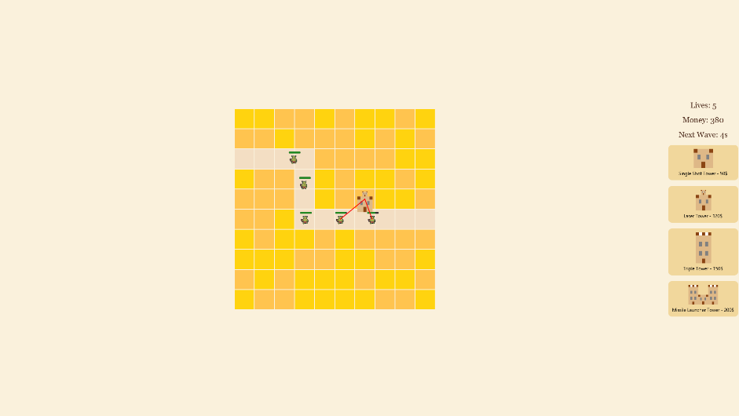
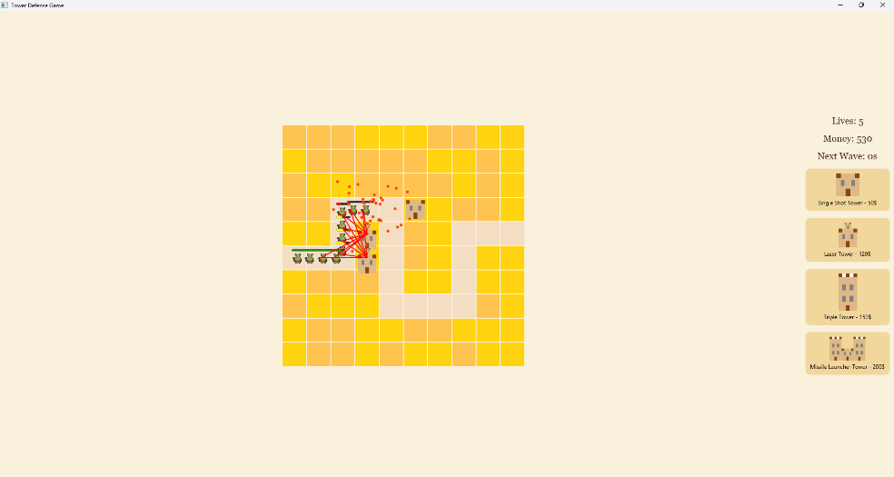
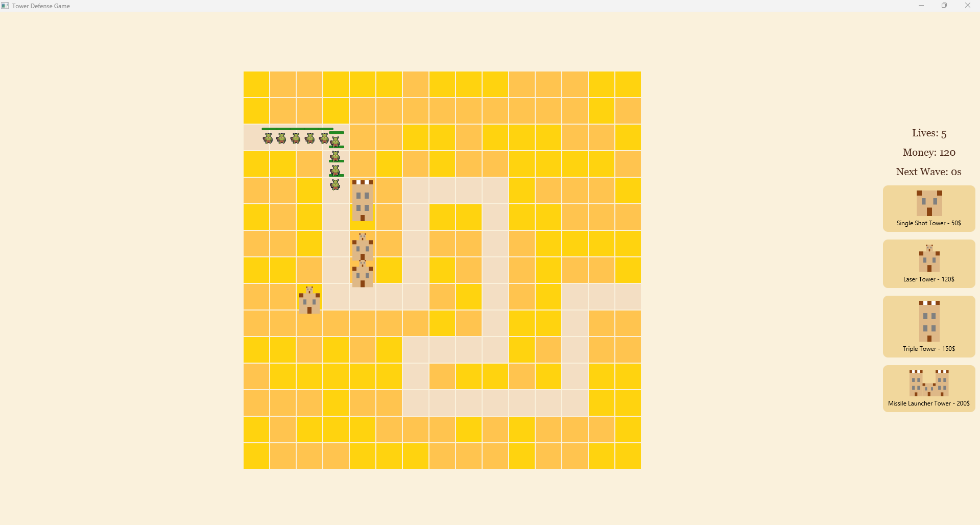
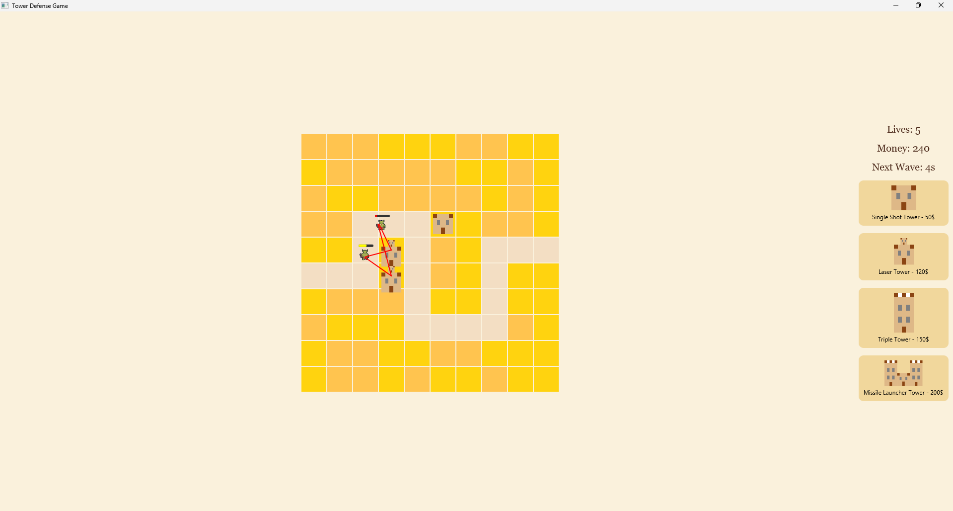
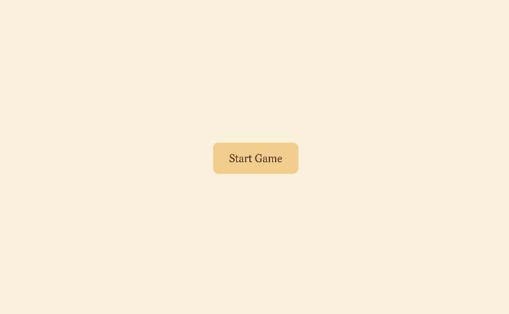
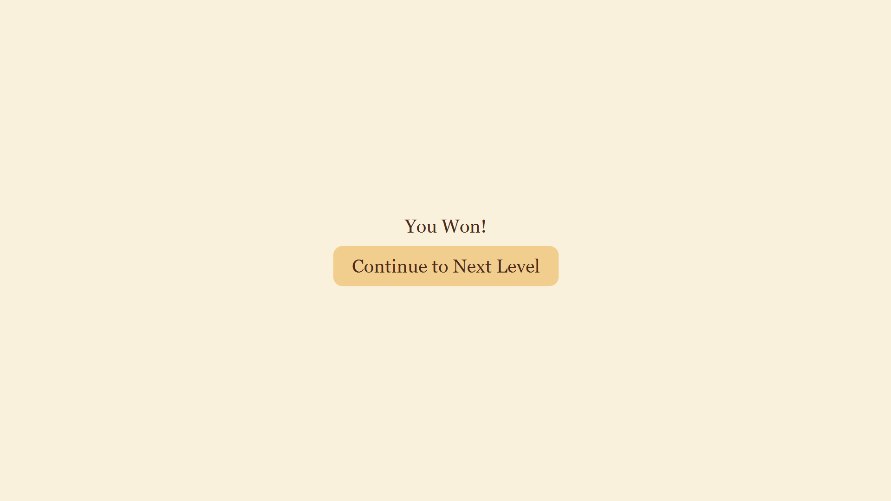
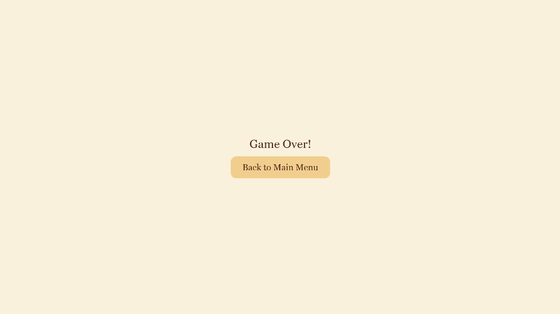
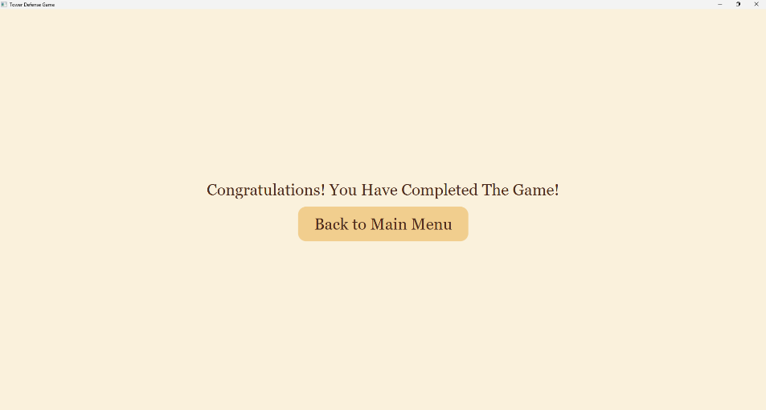

# Tower Defense Game

A 2D tower defense game written in Java with JavaFX. Enemies follow a path across a grid map, and the player drags towers onto the map to stop them before they reach the end. The game has five levels, each loaded from a plain text file.

Developed in May 2025 as a first-year semester project by a team of 3.

The code was written by the team; AI (o4-mini-high) was only used occasionally for debugging.

## Screenshots

| Level 1 | Laser tower and explosions |
|---|---|
|  |  |
| **Larger 15×15 level** | **Towers in action** |
|  |  |

| Main menu | Level won | Game over | Game completed |
|---|---|---|---|
|  |  |  |  |

## Features

- **Five levels loaded from text files** (`level1.txt` … `level5.txt`): map size, enemy path and wave data are all defined in the file. Levels 1–3 use a 10×10 grid, levels 4–5 use 15×15.
- **Wave system**: each level has several waves with their own enemy count, spawn interval and start delay. A countdown to the next wave is shown in the side panel.
- **Drag-and-drop tower placement**: towers are dragged from the side panel onto the map. A dashed circle shows the tower's range while dragging, and the tower snaps to the grid cell it is dropped on.
- **Placement rules**: towers can't be placed on the path or outside the map, and can't be bought without enough money. A short red warning appears at the cursor when a placement is rejected.
- **Selling towers**: right-clicking a placed tower removes it and refunds its full cost. The same tower type then has a 3-second cooldown before it can be placed again.
- **Four tower types** with different attack styles (see below).
- **Enemies** with a health bar that turns from green to yellow (<70%) to red (<40%), a particle explosion when they die, and a fade-out when they reach the end of the path.
- **Economy and lives**: the player starts each level with 5 lives and 500 money and earns 10 money per kill. Each enemy that reaches the end costs one life.
- **Animated map build-up**, plus main menu, "You Won", "Game Over" and "Game Completed" screens.

### Towers

| Tower | Cost | Range (px) | Attack |
|---|---|---|---|
| Single Shot | 50 | 100 | One bullet at the nearest enemy every 1.5 s, 25 damage |
| Laser | 120 | 120 | Continuous beam on every enemy in range, about 20 damage per second |
| Triple Shot | 150 | 150 | Bullets at up to 3 nearest enemies every 2 s, 25 damage each |
| Missile Launcher | 200 | 150 | Missile every 3 s that explodes on impact, 45 damage to all enemies within 50 px |

## Requirements

- JDK 17 or newer
- [JavaFX SDK](https://gluonhq.com/products/javafx/) 17 or newer

Tested with JDK 23 and JavaFX SDK 17.0.15.

## Running the game

The game reads the level files from the current working directory, so it must be started from the `TowerDefenseGame/TowerDefenseGame_` folder. The scripts below take care of that.

### Windows

Run `TowerDefenseGame\start.bat` (double-clicking it works). It compiles the sources into `bin/` and starts the game.

On the first run it asks for the path to the `lib` folder of your JavaFX SDK (for example `C:\javafx-sdk-17.0.15\lib`) and saves it to `TowerDefenseGame\javafx-path.txt`, which is not tracked by git. If the `PATH_TO_FX` environment variable is set, it is used instead.

### macOS / Linux

```bash
export PATH_TO_FX=/path/to/javafx-sdk-17.0.15/lib
cd TowerDefenseGame/TowerDefenseGame_
javac --module-path "$PATH_TO_FX" -d bin src/module-info.java src/application/*.java
cp src/application/*.png src/application/*.css bin/application/
java --module-path "$PATH_TO_FX:bin" --add-modules javafx.controls -m TowerDefenseGame_/application.Game
```

The game opens in full screen. Press `Esc` to leave full screen.

### IDE

The project was originally developed in Eclipse, but IDE project files are not included. To open it in an IDE, create a Java project with `TowerDefenseGame/TowerDefenseGame_/src` as the source folder, add the JavaFX SDK `lib` folder to the module path, and set the working directory of the run configuration to `TowerDefenseGame/TowerDefenseGame_`.

## How to play

1. Click **Start Game**.
2. Drag a tower from the right-hand panel onto a free (non-path) cell of the map.
3. Survive all waves of the level. When every enemy has been killed or has left the map with at least one life remaining, the level is won.
4. Clear all five levels to finish the game. Losing all 5 lives ends the game.

Right-click a placed tower to sell it for a full refund.

## Architecture / How it works

### Project structure

```
TowerDefenseGame/
├── start.bat                  # Windows build-and-run script
└── TowerDefenseGame_/
    ├── level1.txt … level5.txt
    └── src/
        ├── module-info.java
        └── application/
            ├── Game.java
            ├── Map.java, Wave.java, WaveData.java
            ├── Enemy.java
            ├── GameManager.java, GameManagerImpl.java
            ├── TowerPlacementManager.java, TowerViewFactory.java
            ├── SingleShotTower.java, LaserTower.java,
            │   TripleShotTower.java, MissileTower.java
            ├── D_Walk.png      # enemy sprite
            └── application.css
```

### Classes

| Class | Responsibility |
|---|---|
| `Game` | JavaFX `Application` entry point. Builds the main menu, level screen, side panel (lives, money, wave timer, tower icons) and the win / game over / completed screens. Schedules waves and spawns enemies, and runs an `AnimationTimer` that checks whether the level is won or lost. |
| `Map` | Reads a level file and builds the grid as a `GridPane` of rectangles, coloring path cells differently and animating the grid in row by row. Also returns the ordered list of path cells that enemies follow. |
| `Wave` / `WaveData` | `Wave` reads the `WAVE_DATA` section of a level file into a list of `WaveData` objects (enemy count, spawn interval, start delay) and keeps the total number of enemies in the level. |
| `Enemy` | Moves along the path cell by cell with an `AnimationTimer`, draws its sprite and health bar, takes damage, and plays a particle explosion on death or a fade-out on reaching the end. |
| `GameManager` / `GameManagerImpl` | Interface and implementation for shared game state: money, lives, killed and escaped enemy counts. Updates the side panel labels and adds or removes nodes on the game pane. |
| `TowerPlacementManager` | All drag-and-drop logic: makes the tower icons draggable, shows the range preview, validates drops (path cell, outside the map, cooldown, money), creates tower instances, handles right-click selling, and stops all towers when a level ends. |
| `TowerViewFactory` | Draws the four tower graphics from JavaFX rectangles. The bigger towers reuse the smaller ones: the Laser tower is two Single Shot towers stacked, and the Missile Launcher is two Triple Shot towers with a Single Shot tower between them. |
| `SingleShotTower`, `LaserTower`, `TripleShotTower`, `MissileTower` | Each tower places its view on the map and runs a `Timeline` that finds targets in range and attacks them. Bullets and missiles move with `PathTransition`, and the laser draws `Line` beams that follow their targets. |

### Level file format

```
WIDTH:10
HEIGHT:10
2,0
2,1
2,2
...
5,9
WAVE_DATA:
5, 1, 2
8, 0.5, 5
12, 0.3, 5
```

- `WIDTH` / `HEIGHT`: grid size in cells.
- Each `row,column` line marks a path cell. Enemies walk the cells in the order they appear in the file, from the first line (spawn point) to the last (exit).
- Each line after `WAVE_DATA:` is one wave: `enemy count, seconds between spawns, seconds before the wave starts`. A wave's delay starts counting once the previous wave has finished spawning.

`Map` reads the file up to `WAVE_DATA:` for the grid and path, and `Wave` reads the lines after it. A level ends when the number of killed plus escaped enemies equals the total enemy count from all waves. On a win, lives and money are reset to 5 and 500 for the next level.
